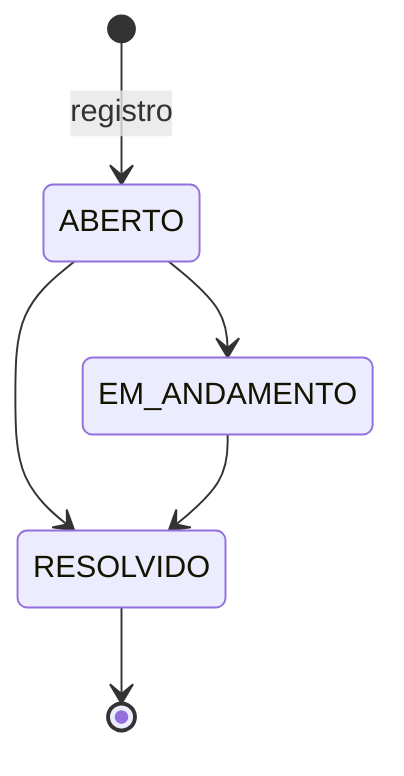
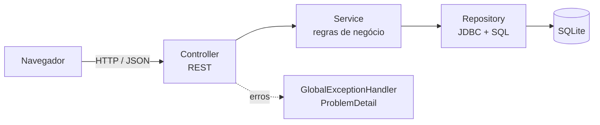
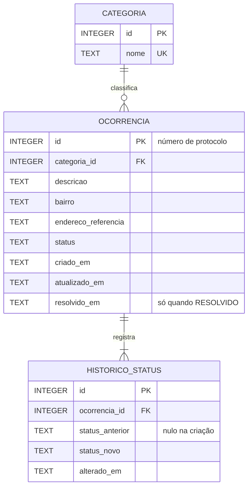

# Bairro em Foco

Aplicação web colaborativa para **registrar e acompanhar problemas de infraestrutura urbana**, como buracos nas ruas, iluminação pública danificada, descarte irregular de lixo e calçadas danificadas.

Projeto acadêmico desenvolvido para a **Global Solution 2026 da FIAP**, com o tema **CitizenTech**: tecnologia a serviço da cidadania e da participação do cidadão na melhoria do espaço urbano.

> **Status:** backend concluído (banco de dados, regras de negócio e API REST, com 145 testes automatizados).
> Próximas etapas: frontend em HTML, CSS e JavaScript e um dashboard com Chart.js.

---

## Sumário

- [O problema](#o-problema)
- [A solução](#a-solução)
- [Funcionalidades](#funcionalidades)
- [Tecnologias](#tecnologias)
- [Arquitetura](#arquitetura)
- [Modelo de dados](#modelo-de-dados)
- [API REST](#api-rest)
- [Como executar](#como-executar)
- [Testes](#testes)
- [Decisões técnicas](#decisões-técnicas)
- [Estrutura do projeto](#estrutura-do-projeto)
- [Próximos passos](#próximos-passos)
- [Documentação complementar](#documentação-complementar)
- [Equipe](#equipe)

---

## O problema

Problemas de infraestrutura no bairro, como um buraco na rua, um poste apagado ou lixo acumulado, costumam ser percebidos por muitos moradores. Mesmo assim:

- não existe um lugar simples e centralizado para registrar o problema;
- quem registra raramente consegue **acompanhar** se o problema está sendo resolvido;
- não há visibilidade sobre **quais problemas são mais frequentes** e **em quais bairros**.

## A solução

O **Bairro em Foco** permite que qualquer pessoa:

1. **Registre** uma ocorrência informando a categoria, uma descrição, o bairro e um endereço ou ponto de referência;
2. **Receba um número de protocolo** para acompanhar a ocorrência;
3. **Consulte o andamento** (`ABERTO` → `EM_ANDAMENTO` → `RESOLVIDO`) e o **histórico completo** de alterações;
4. **Visualize indicadores** sobre as ocorrências (etapa futura, com dashboard).

**Privacidade desde o início:** o registro **não coleta nenhum dado pessoal** (nome, e-mail, telefone ou IP). O cidadão acompanha a ocorrência apenas pelo número de protocolo.

## Funcionalidades

| Funcionalidade | Situação |
|---|---|
| Cadastro de ocorrências com validação e normalização dos dados | ✅ Implementado (API) |
| Consulta por protocolo e listagem com filtros por status e categoria | ✅ Implementado (API) |
| Atualização de status com regras de transição | ✅ Implementado (API) |
| Histórico de todas as alterações de status | ✅ Implementado (API) |
| Listagem de categorias | ✅ Implementado (API) |
| Interface web (HTML, CSS e JavaScript) | 🔜 Próxima etapa |
| Dashboard com indicadores e gráficos (Chart.js) | 🔜 Planejado |

**Categorias:** Buraco na via · Iluminação pública · Descarte irregular de lixo · Calçada danificada · Outros

**Ciclo de vida do status:**



`RESOLVIDO` é um estado **definitivo**: uma ocorrência resolvida não pode ser reaberta.

## Tecnologias

| Camada | Tecnologia |
|---|---|
| Linguagem | Java 21 |
| Framework | Spring Boot 4.1 (Spring MVC, Bean Validation) |
| Banco de dados | SQLite (arquivo local, sem servidor) |
| Acesso a dados | JDBC com `JdbcClient` do Spring, com SQL escrito à mão e **sem JPA/Hibernate** |
| Build | Maven Wrapper (não exige Maven instalado) |
| Testes | JUnit 5, AssertJ, Mockito, MockMvc |
| Frontend (próxima etapa) | HTML, CSS, JavaScript e Chart.js |

O projeto não usa Docker nem servidor de banco de dados externo: basta ter o Java 21 instalado.

## Arquitetura

Aplicação monolítica em camadas. O próprio Spring Boot servirá a API e os arquivos do frontend, a partir de uma única aplicação e de um único comando para executar.



| Camada | Responsabilidade |
|---|---|
| `controller` | Expõe os endpoints REST e converte modelos em DTOs de resposta |
| `service` | Regras de negócio: validação, normalização, transições de status, transações |
| `repository` | Acesso ao SQLite com SQL explícito, uma classe por tabela |
| `model` | Records que espelham as tabelas e o enum `StatusOcorrencia` |
| `dto` | Formato de entrada e saída da API (os records de `model` nunca são expostos) |
| `exception` | Exceções de negócio e tratamento global de erros |
| `config` | Relógio da aplicação (fuso de São Paulo) e verificação do banco na inicialização |

## Modelo de dados



A integridade é garantida também no banco, e não só no Java:

- **chaves estrangeiras** ativadas em toda conexão (`PRAGMA foreign_keys=ON`) e `ON DELETE RESTRICT`;
- **restrições `CHECK`** de tamanho dos textos, de valores válidos de status e de coerência de datas (por exemplo, `resolvido_em` existe se e somente se o status é `RESOLVIDO`);
- **índices** nas chaves estrangeiras e no status, usados pelos filtros e pelo histórico.

Detalhes completos, incluindo as consultas planejadas para o dashboard, estão em [docs/modelo-dados.md](docs/modelo-dados.md).

## API REST

| Método | Rota | Descrição |
|---|---|---|
| `GET` | `/api/categorias` | Lista as categorias |
| `POST` | `/api/ocorrencias` | Registra uma ocorrência (retorna `201` e o protocolo) |
| `GET` | `/api/ocorrencias?status=&categoriaId=` | Lista as ocorrências, com filtros opcionais |
| `GET` | `/api/ocorrencias/{id}` | Consulta uma ocorrência pelo protocolo |
| `GET` | `/api/ocorrencias/{id}/historico` | Linha do tempo de status |
| `PATCH` | `/api/ocorrencias/{id}/status` | Atualiza o status |

**Exemplo: registrar uma ocorrência**

```http
POST /api/ocorrencias
Content-Type: application/json

{
  "categoriaId": 1,
  "descricao": "Buraco grande na faixa da direita",
  "bairro": "Vila Nova",
  "enderecoReferencia": "Rua das Flores, 100"
}
```

```json
{
  "id": 1,
  "categoria": { "id": 1, "nome": "Buraco na via" },
  "descricao": "Buraco grande na faixa da direita",
  "bairro": "Vila Nova",
  "enderecoReferencia": "Rua das Flores, 100",
  "status": "ABERTO",
  "criadoEm": "2026-11-14T08:00:00",
  "atualizadoEm": "2026-11-14T08:00:00",
  "resolvidoEm": null
}
```

Os erros seguem o padrão **[RFC 9457 – Problem Details](https://www.rfc-editor.org/rfc/rfc9457)** (`application/problem+json`), com mensagens em português e erros indicados por campo:

```json
{
  "title": "Dados inválidos",
  "status": 400,
  "detail": "Um ou mais campos estão inválidos.",
  "instance": "/api/ocorrencias",
  "erros": { "descricao": "A descrição deve ter entre 10 e 1000 caracteres" }
}
```

| Código | Situação |
|---|---|
| 400 | Dados inválidos, JSON malformado ou tipo incorreto |
| 404 | Ocorrência não encontrada |
| 409 | Conflito: o status foi alterado por outra operação |
| 422 | Transição de status não permitida |
| 500 | Erro inesperado. A mensagem é genérica e nenhum detalhe interno é exposto. |

A documentação completa, com todos os exemplos e um roteiro de testes manuais, está em [docs/api.md](docs/api.md).

## Como executar

### Pré-requisitos

- **Java 21** (JDK). Para verificar: `java -version`
- Não é necessário instalar o Maven nem um servidor de banco de dados.

### Passo a passo

```bash
git clone <url-do-repositório>
cd <pasta-do-projeto>
```

**Windows (PowerShell):**

```powershell
.\mvnw.cmd spring-boot:run
```

**Linux / macOS:**

```bash
./mvnw spring-boot:run
```

A aplicação sobe em **http://localhost:8080**. Teste a API com:

```bash
curl http://localhost:8080/api/categorias
```

Na primeira execução, o banco é criado automaticamente em `data/bairro-em-foco.db`, já com as categorias iniciais. O log de inicialização confirma a conexão:

```
SQLite conectado: ...\data\bairro-em-foco.db | foreign_keys=ON | categorias cadastradas: 5
```

> A interface web ainda não foi implementada. Por enquanto, a raiz `http://localhost:8080/` retorna 404, o que é esperado.

### Recriar o banco de desenvolvimento

O `schema.sql` só cria o que ainda não existe e **nunca apaga dados**. Para começar com um banco limpo, pare a aplicação e renomeie (ou apague) `data/bairro-em-foco.db`. O procedimento seguro está descrito em [docs/modelo-dados.md](docs/modelo-dados.md#evolução-do-schema-e-recriação-do-banco-de-desenvolvimento).

## Testes

```powershell
.\mvnw.cmd test        # Windows
./mvnw test            # Linux / macOS
```

**145 testes automatizados**, todos passando:

| Área | Testes | O que garantem |
|---|---|---|
| Banco de dados | 38 | Restrições `NOT NULL`, `CHECK`, `UNIQUE`, chaves estrangeiras, índices, idempotência dos scripts, persistência |
| Repositories | 29 | Inserções, consultas, filtros, ordenação, atualização de status, conversão de datas |
| Services | 38 | Validação, normalização do bairro, todas as transições permitidas e proibidas, conflito de atualização, **rollback** da transação |
| API REST | 37 | Contrato HTTP de cada endpoint, formato JSON, códigos de erro, `ProblemDetail`, ausência de detalhes internos em erros 500, fluxo completo até o banco |
| Aplicação | 3 | Inicialização do contexto e relógio da aplicação |

Os testes usam um **banco SQLite separado** em `target/`, recriado a cada execução, e nunca alteram o banco de desenvolvimento.

## Decisões técnicas

- **JDBC puro em vez de JPA.** O SQL fica explícito e fácil de explicar, o comportamento é previsível e o projeto é adequado ao escopo. O `JdbcClient` do Spring evita código repetitivo sem esconder as consultas.
- **SQLite.** Banco em um único arquivo, sem instalação nem servidor. É ideal para um projeto acadêmico e para rodar em qualquer máquina com Java.
- **Validação em duas camadas.** As mensagens amigáveis vêm do Bean Validation no Java, e as restrições `CHECK` no banco são a última linha de defesa.
- **Normalização antes da validação.** Os espaços extras são removidos, e no bairro `"  Vila   Nova "` vira `"Vila Nova"`. Isso evita que o mesmo bairro apareça duplicado nas estatísticas.
- **Histórico transacional.** A ocorrência e o seu registro de histórico são gravados na **mesma transação**: ou as duas gravações acontecem, ou nenhuma. Há testes que provocam uma falha no histórico e verificam o rollback.
- **Proteção contra atualização concorrente.** A mudança de status só é aplicada se o status atual ainda for o esperado (`UPDATE ... WHERE status = :statusAtual`). Caso contrário, a API responde `409 Conflict`.
- **Datas com um relógio único.** As datas são geradas por um `Clock` no fuso `America/Sao_Paulo`, com precisão de segundos, o que permite fixar o horário nos testes. No banco, ficam no formato `YYYY-MM-DD HH:MM:SS`, compatível com as funções de data do SQLite.
- **Uma conexão no pool.** O SQLite aceita uma escrita por vez, e uma única conexão evita erros de `database is locked`.
- **Erros padronizados (RFC 9457).** As exceções de negócio e os erros do próprio Spring seguem o mesmo formato, e erros inesperados nunca expõem SQL, stack traces ou mensagens internas.

## Estrutura do projeto

```
├── data/                        # banco SQLite de desenvolvimento (ignorado pelo Git)
├── docs/
│   ├── api.md                   # documentação da API REST
│   └── modelo-dados.md          # modelo de dados, decisões e consultas do dashboard
├── src/
│   ├── main/
│   │   ├── java/br/com/bairroemfoco/
│   │   │   ├── config/          # Clock, verificação do banco na inicialização
│   │   │   ├── controller/      # endpoints REST
│   │   │   ├── dto/             # entrada e saída da API
│   │   │   ├── exception/       # exceções de negócio e GlobalExceptionHandler
│   │   │   ├── model/           # records das tabelas e enum de status
│   │   │   ├── repository/      # acesso ao SQLite via JdbcClient
│   │   │   └── service/         # regras de negócio
│   │   └── resources/
│   │       ├── application.properties
│   │       ├── schema.sql       # criação das tabelas e índices
│   │       ├── data.sql         # categorias iniciais
│   │       └── static/          # frontend (próxima etapa)
│   └── test/                    # testes unitários e de integração
├── mvnw, mvnw.cmd               # Maven Wrapper
└── pom.xml
```

## Próximos passos

- [ ] **Frontend** em HTML, CSS e JavaScript (`src/main/resources/static/`): formulário de registro, consulta por protocolo, listagem com filtros e linha do tempo do histórico.
- [ ] **Dashboard** com Chart.js: totais por status, ocorrências por categoria e por bairro, evolução diária, taxa de resolução e tempo médio de resolução. As consultas SQL já estão especificadas em [docs/modelo-dados.md](docs/modelo-dados.md#consultas-do-dashboard).

**Fora do escopo do MVP:** autenticação, upload de imagens, geolocalização automática e integração com órgãos públicos.

## Documentação complementar

- [docs/modelo-dados.md](docs/modelo-dados.md): tabelas, restrições, índices, datas, ciclo de vida do status e consultas do dashboard
- [docs/api.md](docs/api.md): endpoints, exemplos de requisição e resposta, formato de erros e testes manuais

## Equipe

> _Adicionar aqui os nomes e RMs dos integrantes._

---

Projeto acadêmico, FIAP, Global Solution 2026, tema CitizenTech.
