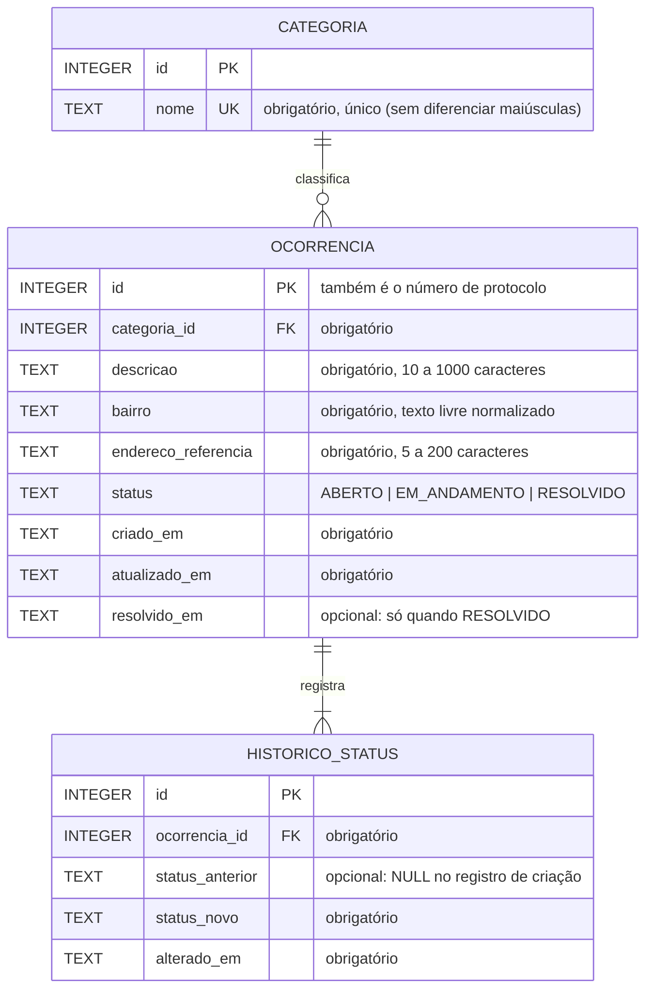
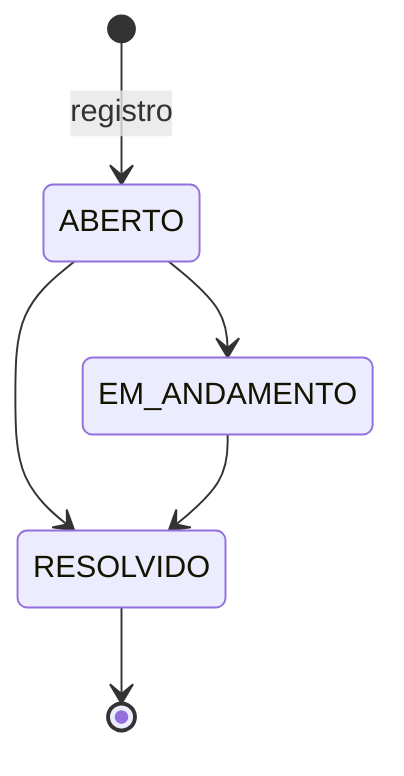

# Modelo de dados — Bairro em Foco

Banco: **SQLite**, acessado via **JDBC** (`JdbcClient` do Spring), sem JPA/Hibernate.
Definição oficial: [`src/main/resources/schema.sql`](../src/main/resources/schema.sql).
Dados iniciais: [`src/main/resources/data.sql`](../src/main/resources/data.sql).

## Diagrama entidade-relacionamento



## Relacionamentos e cardinalidades

| Relacionamento | Cardinalidade | Regra |
|---|---|---|
| `categoria` → `ocorrencia` | 1 : N | Toda ocorrência tem exatamente uma categoria. Uma categoria pode ter zero ou mais ocorrências. |
| `ocorrencia` → `historico_status` | 1 : N (mínimo 1) | Toda ocorrência tem ao menos um registro de histórico, o da criação (`NULL → ABERTO`). |

As duas chaves estrangeiras usam `ON DELETE RESTRICT`: não é possível excluir uma categoria em uso
nem uma ocorrência que tenha histórico. O MVP não prevê exclusões.

As chaves estrangeiras vêm **desligadas por padrão** no SQLite. A aplicação as ativa em toda conexão com
`spring.datasource.hikari.connection-init-sql=PRAGMA foreign_keys=ON`, e a inicialização falha se
o PRAGMA não estiver ativo (`DatabaseStartupCheck`).

## Tabelas

### `categoria`

| Coluna | Tipo | Obrigatório | Restrições |
|---|---|---|---|
| `id` | INTEGER | sim | PK, `AUTOINCREMENT` |
| `nome` | TEXT | sim | `UNIQUE COLLATE NOCASE`, sem espaços nas pontas, 1 a 60 caracteres |

Categorias iniciais: *Buraco na via*, *Iluminação pública*, *Descarte irregular de lixo*,
*Calçada danificada* e *Outros*.

### `ocorrencia`

| Coluna | Tipo | Obrigatório | Restrições |
|---|---|---|---|
| `id` | INTEGER | sim | PK, `AUTOINCREMENT`. Usado como **protocolo** e nunca reutilizado. |
| `categoria_id` | INTEGER | sim | FK → `categoria(id)` |
| `descricao` | TEXT | sim | 10 a 1000 caracteres (sem contar espaços nas pontas) |
| `bairro` | TEXT | sim | `COLLATE NOCASE`, sem espaços nas pontas nem duplos, 2 a 80 caracteres |
| `endereco_referencia` | TEXT | sim | Endereço **ou** ponto de referência, 5 a 200 caracteres |
| `status` | TEXT | sim | `DEFAULT 'ABERTO'`, valores `ABERTO`, `EM_ANDAMENTO` ou `RESOLVIDO` |
| `criado_em` | TEXT | sim | Data de registro |
| `atualizado_em` | TEXT | sim | `>= criado_em` |
| `resolvido_em` | TEXT | não | Preenchido **se e somente se** `status = 'RESOLVIDO'`, e `>= criado_em` |

### `historico_status`

| Coluna | Tipo | Obrigatório | Restrições |
|---|---|---|---|
| `id` | INTEGER | sim | PK, `AUTOINCREMENT` |
| `ocorrencia_id` | INTEGER | sim | FK → `ocorrencia(id)` |
| `status_anterior` | TEXT | não | Um dos 3 status. `NULL` apenas no registro de criação. |
| `status_novo` | TEXT | sim | Um dos 3 status. Diferente de `status_anterior`. |
| `alterado_em` | TEXT | sim | Data da alteração |

## Decisões de modelagem

- **Sem dados pessoais.** Não são coletados nome, e-mail, telefone nem IP. O cidadão acompanha a ocorrência pelo número de protocolo, que é o `id`.
- **Status como `TEXT` + `CHECK`**, sem tabela própria. Os valores são fixos e espelham o `enum` Java.
- **Status atual guardado em `ocorrencia`.** É uma desnormalização intencional que simplifica a listagem, os filtros e o dashboard. O histórico mantém a trilha completa.
- **Bairro como texto livre.** O serviço remove os espaços extras antes de salvar, e o banco recusa espaços nas pontas e espaços duplos. O `COLLATE NOCASE` faz "Centro" e "CENTRO" serem agrupados juntos. Limitação: o `NOCASE` só trata letras ASCII, então "SÉ" e "sé" continuam diferentes.
- **Validação em duas camadas.** O Bean Validation nos DTOs gera mensagens amigáveis. Os `CHECK` no banco são a última linha de defesa, já que o `TEXT` do SQLite não tem limite de tamanho. Os limites são os mesmos nas duas camadas.

### Datas

O SQLite não tem tipo de data. As datas são `TEXT` no formato **`YYYY-MM-DD HH:MM:SS`**, no **horário de São Paulo**, por três motivos:

- o formato é legível;
- a ordem alfabética coincide com a ordem cronológica, o que permite os `CHECK` de comparação;
- é o formato nativo das funções `date()`, `strftime()` e `julianday()`.

As datas são geradas pela **aplicação**, com um `Clock` em `America/Sao_Paulo`, e não por `CURRENT_TIMESTAMP`. Este último usa UTC e deslocaria para o dia seguinte as ocorrências registradas à noite.

| Campo | Quando é preenchido |
|---|---|
| `criado_em` | Na criação. Nunca muda. |
| `atualizado_em` | Na criação e a cada mudança de status |
| `resolvido_em` | Quando o status passa para `RESOLVIDO` |
| `alterado_em` | Em cada registro de histórico |

### Ciclo de vida do status



`RESOLVIDO` é **definitivo**: uma ocorrência resolvida não pode ser reaberta no MVP. Transições para o mesmo status
são rejeitadas. As regras de transição ficam no serviço, porque um `CHECK` não enxerga o valor anterior.

### Garantia do histórico

A ocorrência e o histórico são gravados **na mesma transação** (`@Transactional` no serviço). Se um
dos comandos falhar, nenhum é aplicado.

- **Registro:** `INSERT` em `ocorrencia` (status `ABERTO`) e `INSERT` em `historico_status` (`NULL → ABERTO`).
- **Mudança de status:**

```sql
UPDATE ocorrencia
   SET status = :novo,
       atualizado_em = :agora,
       resolvido_em = CASE WHEN :novo = 'RESOLVIDO' THEN :agora END
 WHERE id = :id AND status = :statusAtual;   -- 0 linhas = inexistente ou status já alterado

INSERT INTO historico_status (ocorrencia_id, status_anterior, status_novo, alterado_em)
VALUES (:id, :statusAtual, :novo, :agora);
```

Não foi usada trigger no banco por três motivos:

- a regra de negócio ficaria escondida no SQL;
- o executor de scripts do Spring separa os comandos por `;`, o que quebra o `BEGIN ... END;` de uma trigger;
- a lógica ficaria mais difícil de testar e explicar.

### Índices

O SQLite indexa automaticamente apenas a PK e as colunas `UNIQUE`. **Chaves estrangeiras não são indexadas.**

| Índice | Justificativa |
|---|---|
| `idx_historico_ocorrencia (ocorrencia_id, alterado_em)` | Linha do tempo de uma ocorrência, já ordenada |
| `idx_ocorrencia_status (status)` | Filtro principal da listagem e base do dashboard |
| `idx_ocorrencia_categoria (categoria_id)` | Filtro por categoria. Também evita varrer a tabela ao verificar o `RESTRICT`. |

Não há índice em `criado_em` porque o `id` cresce com o tempo: `ORDER BY id DESC` dá a ordem
"mais recentes primeiro" usando a PK.

## Consultas do dashboard

```sql
-- Totais por status (cards de indicadores)
SELECT status, COUNT(*) AS total FROM ocorrencia GROUP BY status;

-- Ocorrências por categoria (o LEFT JOIN inclui categorias sem ocorrências, com total 0)
SELECT c.nome, COUNT(o.id) AS total
  FROM categoria c
  LEFT JOIN ocorrencia o ON o.categoria_id = c.id
 GROUP BY c.id, c.nome
 ORDER BY total DESC;

-- Categoria × status (barras empilhadas)
SELECT c.nome,
       COALESCE(SUM(o.status = 'ABERTO'), 0)       AS abertas,
       COALESCE(SUM(o.status = 'EM_ANDAMENTO'), 0) AS em_andamento,
       COALESCE(SUM(o.status = 'RESOLVIDO'), 0)    AS resolvidas
  FROM categoria c
  LEFT JOIN ocorrencia o ON o.categoria_id = c.id
 GROUP BY c.id, c.nome;

-- Bairros com mais ocorrências
SELECT bairro, COUNT(*) AS total
  FROM ocorrencia
 GROUP BY bairro
 ORDER BY total DESC
 LIMIT 10;

-- Novas ocorrências por dia (:dataInicio calculada no Java, ex.: hoje - 30 dias)
SELECT date(criado_em) AS dia, COUNT(*) AS total
  FROM ocorrencia
 WHERE criado_em >= :dataInicio
 GROUP BY dia
 ORDER BY dia;

-- Taxa de resolução (%)
SELECT COALESCE(ROUND(100.0 * SUM(status = 'RESOLVIDO') / COUNT(*), 1), 0) AS taxa
  FROM ocorrencia;

-- Tempo médio de resolução em dias, por categoria
SELECT c.nome, ROUND(AVG(julianday(o.resolvido_em) - julianday(o.criado_em)), 1) AS dias
  FROM ocorrencia o
  JOIN categoria c ON c.id = o.categoria_id
 WHERE o.resolvido_em IS NOT NULL
 GROUP BY c.id, c.nome;
```

Observações:

- No SQLite, uma comparação como `status = 'ABERTO'` vale `1` ou `0`, então `SUM(...)` funciona como um "contar se".
- Em uma categoria sem ocorrências, o `SUM` sobre as linhas nulas do `LEFT JOIN` retorna `NULL`. O `COALESCE` converte esse valor para `0`. O `COUNT(o.id)` já retorna `0` nesse caso.

## Mapeamento para Java

| Tabela | Modelo (`model/`) | Repositório (`repository/`) |
|---|---|---|
| `categoria` | `Categoria` (record) | `CategoriaRepository`: `listarTodas`, `buscarPorId` |
| `ocorrencia` | `Ocorrencia` (record) | `OcorrenciaRepository`: `inserir`, `buscarPorId`, `listar(status, categoriaId)`, `atualizarStatus` |
| `historico_status` | `HistoricoStatus` (record) | `HistoricoStatusRepository`: `inserir`, `listarPorOcorrencia` |
| coluna `status` | `StatusOcorrencia` (enum) | gravado com `name()`, lido com `valueOf` |

- Colunas em `snake_case` viram componentes em `camelCase`. As datas são `LocalDateTime` no Java e são convertidas para o formato do banco por `DataHoraSqlite`.
- Os repositórios **não geram datas** e **não aplicam regras de negócio**: recebem os valores prontos do serviço. As datas vêm do `Clock` definido em `ClockConfig` (`America/Sao_Paulo`, precisão de segundos).
- O `atualizarStatus` só altera a ocorrência se o status atual ainda for o informado (`WHERE ... AND status = :statusAtual`) e devolve `false` caso contrário.

## Testes

| Classe | O que valida |
|---|---|
| `SqliteConnectionTests` | PRAGMA `foreign_keys` ativo, scripts idempotentes (5 categorias), índices criados, persistência em arquivo, rollback da transação ocorrência + histórico |
| `ModeloDadosTests` | Categorias iniciais, `UNIQUE`/`NOCASE`, `NOT NULL`, `CHECK` de cada campo, chaves estrangeiras, `RESTRICT`, linha do tempo do histórico e `COALESCE` do dashboard |
| `CategoriaRepositoryTests`, `OcorrenciaRepositoryTests`, `HistoricoStatusRepositoryTests` | Inserções, consultas, filtros, ordenação, atualização de status e relacionamentos via repositórios |
| `DataHoraSqliteTests`, `ClockConfigTests` | Conversão de datas e relógio da aplicação (testes unitários, sem Spring) |

Os testes das camadas de serviço (`service/`) e da API (`controller/`, `exception/`) ficam nos pacotes de mesmo nome
em `src/test/java`. O contrato da API está documentado em [api.md](api.md).

Os testes usam um banco próprio em `target/bairro-em-foco-test.db`. Esse banco é recriado a cada execução por
`src/test/resources/reset-test.sql` e nunca afeta o banco de desenvolvimento.

O Spring não traduz os códigos de erro do SQLite (o SQL state é nulo): as violações chegam como
`UncategorizedSQLException`. Uma exclusão bloqueada por `RESTRICT` gera `SQLITE_CONSTRAINT_TRIGGER`, e não
`SQLITE_CONSTRAINT_FOREIGNKEY`. O tratamento global de erros precisa considerar isso.

## Evolução do schema e recriação do banco de desenvolvimento

O `schema.sql` usa apenas `CREATE ... IF NOT EXISTS`, que **não altera tabelas já existentes**. Quando a
estrutura muda, o banco de desenvolvimento precisa ser recriado:

1. **Pare a aplicação.** Feche também o DB Browser ou qualquer programa que esteja com o banco aberto.
2. **Confira o conteúdo** do `data/bairro-em-foco.db`. Se houver registros importantes, **não recrie**: escreva um script de migração (`ALTER TABLE` ou cópia para uma nova tabela).
3. **Faça um backup em vez de apagar.** No PowerShell, na raiz do projeto:
   ```powershell
   Rename-Item data\bairro-em-foco.db "bairro-em-foco.$(Get-Date -Format yyyyMMdd-HHmmss).bak.db"
   ```
   Os backups ficam em `data/`, que é ignorada pelo Git.
4. **Inicie a aplicação** (`.\mvnw.cmd spring-boot:run`). O banco é recriado com o schema atual e as categorias iniciais.
